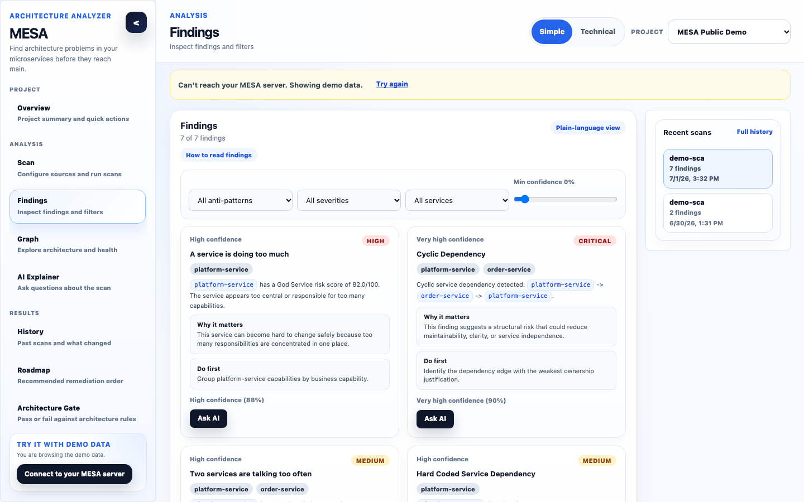
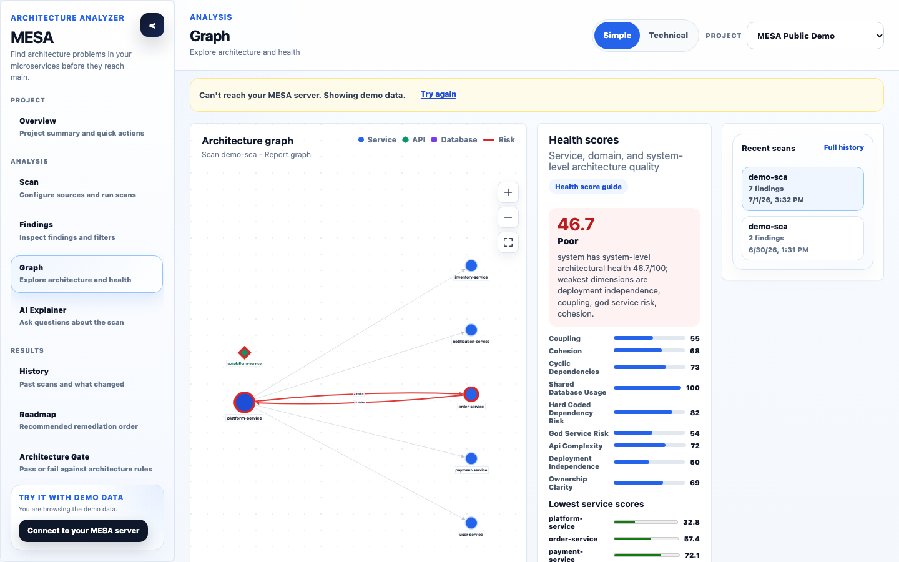

# MESA

**Find architecture problems in your microservices before they reach main.**

[](https://github.com/ilmeedesilva/MESA/actions/workflows/ci.yml)
<!-- Badges added at the 1.0 release: PyPI version, license, GitHub Marketplace. -->

MESA reads the source code and configuration of all your services together and finds the
problems that only show up *between* services: a call cycle, two services sharing one
database, a service address written into the code, a service that does too much. On a pull
request it comments with the new problems, the file and line, why each one matters and how to
fix it, and fails the check only when the change makes the architecture worse.

It is static analysis: your code is never run and is not sent to any outside service.

<!-- Before the 1.0 release: replace the excerpt below with docs/images/pr-comment.png,
     a screenshot of the comment on a real pull request. -->

**What the pull request comment looks like** (shortened):

> ## ❌ MESA architecture check: FAILED (3 new problems, 0 fixed)
>
> **Health score:** 98.7 → 79.7 (-19.0, allowed drop is 5.0)
>
> #### 🔴 CRITICAL Cyclic dependency: order-service → user-service → order-service
>
> - `order-service/app.py:30` calls `http://user-service:8080/users/1`
> - `user-service/app.py:26` calls `http://order-service:8080/orders/1`
>
> **Why it matters:** The cycle blocks independent deployment, increases change coordination,
> and can turn microservices into a distributed monolith.
>
> **How to fix:** Identify the dependency edge in the cycle with the weakest ownership
> justification. Reverse that dependency, replace it with an event, or introduce an
> orchestration/application service.

The full example is [`tests/fixtures/reports/pr-new-cycle.md`](tests/fixtures/reports/pr-new-cycle.md).

## Use it in CI in 30 seconds

Add this workflow to a repository with microservices:

```yaml
# .github/workflows/architecture.yml
name: Architecture check

on:
  pull_request:

permissions:
  contents: read
  pull-requests: write # for the pull request comment

jobs:
  mesa:
    runs-on: ubuntu-latest
    steps:
      - uses: actions/checkout@v7
      - uses: ilmeedesilva/MESA@<commit-sha> # pin a full commit SHA
```

On every pull request MESA scans the change and its base commit, posts one comment (and
updates it on later pushes), writes the report to the job summary, and fails the check only
when the change *adds* a problem. Problems that were already there do not block you.

Inputs (folder to scan, thresholds, SARIF upload for code scanning, report-only mode) and
outputs are listed in [CI and the GitHub Action](docs/guides/ARCHITECTURE_FITNESS_GATE_CI.md#github-action).
An optional `.mesa.yml` file sets which folders are services and how strict the check is.

**Coming in 1.0:** a short `uses: ilmeedesilva/mesa-action@v1` on the GitHub Marketplace,
installing MESA from PyPI.

## Try it locally

You need Python 3.10 or later.

```bash
git clone https://github.com/ilmeedesilva/MESA.git
cd MESA
python -m venv .venv && source .venv/bin/activate
pip install .

mesa scan tests/fixtures/cycle    # a small example with a call cycle
mesa scan /path/to/your/repo      # finds the services and lists the problems
```

**Coming in 1.0:** `pip install mesa-analyzer` from PyPI.

To check a branch the way the Action does, run `mesa ci --base-ref origin/main` in your
repository. It exits with `0` when the check passes, `1` when it fails and `2` on a usage or
configuration error.

### The web app

The web app shows the findings, an interactive architecture graph, health scores, scan
history and a fix-first roadmap, and can explain a finding in plain words (built in, or with
OpenAI or Anthropic if you add a key). It needs Docker:

```bash
docker compose up --build
```

Then open <http://localhost:5173>. If the app can't reach its server, it shows demo data.





## What it detects

| Problem | What MESA looks for |
| --- | --- |
| Cyclic dependency | Services that call each other in a loop, directly or through others. |
| Shared database | Two or more services connecting to the same database. |
| Hard-coded service dependency | Service URLs, private IPs and local ports written into code or config instead of configuration or service discovery. |
| Chatty services | One service calling another from many places. |
| God service | One service with too many endpoints, dependencies and responsibilities. |
| Policy violations | Your own rules, for example no hard-coded URLs or a maximum number of outbound dependencies per service ([policies guide](docs/guides/GOVERNANCE_GUIDE.md)). |

Each finding comes with the files and lines it is based on, why it matters, the steps to fix
it, and a health score for each service and for the whole system.

**Languages:** Python (parsed into a syntax tree), JavaScript and TypeScript, Java and Go
(read with patterns), plus `.env`, YAML, `.properties`, `requirements.txt`, `package.json`,
`pom.xml` and OpenAPI files.

## Results

MESA was measured against hand-labelled benchmarks: 8 seeded systems built to contain known
problems, and 3 public open-source microservice projects pinned to fixed commits.

| Benchmark | Correct | Wrong | Missed | Precision | Recall | F1 |
| --- | --- | --- | --- | --- | --- | --- |
| Seeded (8 systems, 32 services) | 76 | 0 | 0 | 1.0000 | 1.0000 | 1.0000 |
| Online Boutique | 2 | 0 | 0 | 1.0000 | 1.0000 | 1.0000 |
| Spring Boot sample | 24 | 0 | 0 | 1.0000 | 1.0000 | 1.0000 |
| Sock Shop | 4 | 0 | 0 | 1.0000 | 1.0000 | 1.0000 |

These are the frozen results of the tagged research version `v0.1.0-research`. Benchmarks
measure only what they label, so a perfect score here does not mean MESA finds every problem
in every codebase (see [Limitations](#limitations)). To run them yourself in about five
minutes, and to see what changed in later versions, follow
[REPRODUCE.md](docs/research/REPRODUCE.md).

## How it works

```text
repository ──▶ discover services ──▶ extract facts ──▶ build graph ──▶ detectors ──▶ health scores
                                                                                    + recommendations
                                                                                          │
                     PR comment · SARIF · job summary · JSON ◀── compare with base ◀──────┘
```

1. **Discover services** (`src/mesa/discovery/`). Folders are scored by what they contain
   (`pyproject.toml`, `package.json`, `pom.xml`, `go.mod`, a Dockerfile, an OpenAPI file, ...)
   and the likely ones become services. Tests,
   fixtures, examples, docs and vendored code are skipped. `.mesa.yml` can list services
   explicitly.
2. **Extract facts** (`src/mesa/analysis/extractor.py`). Per service: outbound HTTP calls,
   database connection settings, endpoints, dependencies and hard-coded addresses, each with
   its file and line.
3. **Build the graph** (`src/mesa/graph/`). Services, APIs and databases become nodes and calls
   become edges in a NetworkX graph. The web app also stores it in Neo4j for graph queries.
4. **Run the detectors** (`src/mesa/detectors/`). One small class per problem type, each
   working on the graph and the extracted facts. Results are deterministic: the same code
   gives the same findings every time.
5. **Score and explain** (`src/mesa/analysis/`). Health scores per service, domain and system,
   and a recommendation for each finding, built from its evidence.
6. **Compare and report** (`src/mesa/ci.py`, `src/mesa/reporting/`). In CI the base commit is
   scanned the same way. Findings are matched by a fingerprint that ignores line numbers
   (`src/mesa/fingerprint.py`), so moving code does not make an old problem look new. The
   result becomes the Markdown comment, SARIF, annotations and JSON.

The web app is a FastAPI server (`src/mesa/api/`, with PostgreSQL and Neo4j) and a React +
TypeScript frontend (`frontend/`). Setup, tests and project layout are in the
[developer guide](docs/guides/DEVELOPER_GUIDE.md).

## Limitations

MESA reads code without running it, so it sees only what is written down:

- **Python calls need a plain string URL.** `requests.get("http://user-service:8080/users/1")`
  is seen. A URL in an f-string (`f"http://user-service/{user_id}"`), built from variables, or
  passed as a keyword argument is not, so that call adds no edge to the graph and cannot be
  part of a cycle or a chatty pair. The address is still reported as hard-coded.
- **JavaScript, TypeScript, Java and Go are read with patterns, not a full parser.** URLs built
  at runtime, read from configuration or produced by a client library are missed.
- **Only HTTP calls and database connections count as dependencies.** Message queues (Kafka,
  RabbitMQ) and gRPC are not followed yet.
- **Service discovery is a heuristic.** In repositories with unusual layouts it can report too
  many or too few services. List them in `.mesa.yml` to be exact.
- **Thresholds and health-score weights are defaults**, not universal truths. Adjust them in
  `.mesa.yml` to fit your system.

More detail is in [Supported inputs](docs/guides/SUPPORTED_INPUTS.md).

## Research and reproducibility

MESA started as a research project. The method, the benchmarks and the full results are kept
in [`docs/research/`](docs/research/):

- [REPRODUCE.md](docs/research/REPRODUCE.md): reproduce every result from the tagged version
- [Evaluation setup and results](docs/research/EVALUATION_SETUP_AND_RESULTS.md)
- [Methodology](docs/research/METHODOLOGY.md) and [threats to validity](docs/research/THREATS_TO_VALIDITY.md)
- [Detection algorithms](docs/research/DETECTION_ALGORITHMS.md) and [system architecture](docs/research/SYSTEM_ARCHITECTURE.md)
- [Comparison with general-purpose AI models](docs/research/AI_BASELINE_COMPARISON.md)
- [Index of all research documents](docs/research/PHASE_12_DOCUMENTATION_INDEX.md)

The benchmark definitions are in [`benchmarks/`](benchmarks/) and the frozen result files in
[`evaluation-results/`](evaluation-results/). They are never edited; results from later
versions are stored separately.

## Documentation

- [Installation](docs/guides/INSTALLATION_GUIDE.md) and [user guide](docs/guides/USER_GUIDE.md)
- [CI and the GitHub Action](docs/guides/ARCHITECTURE_FITNESS_GATE_CI.md)
- [Reading findings](docs/guides/FINDINGS_GUIDE.md) and [the health score](docs/guides/HEALTH_SCORE_GUIDE.md)
- [API reference](docs/api/API_DOCUMENTATION.md) (the running server also serves it at <http://localhost:8000/docs>)
- [Developer guide](docs/guides/DEVELOPER_GUIDE.md)
