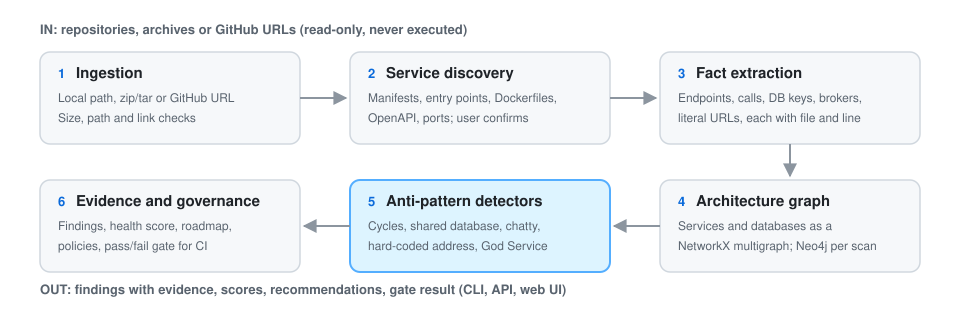

# How MESA works

MESA treats a set of microservice repositories as one system. It reads source code and
configuration without running anything, builds a graph of how the services talk to each other,
and runs rule-based detectors over that graph. Every finding carries the evidence it was built
from (file and line), a confidence rationale, and the limits of what it proves.

## Pipeline

| Stage | What happens | Code |
| --- | --- | --- |
| 1. Ingestion | Accepts a local directory, a `.zip`/`.tar` archive, a public GitHub URL (downloaded as an archive), or an explicit list of service paths. Archives are extracted into a temporary workspace with size, file-count, path-traversal and link checks. Nothing in the target is executed. | `src/mesa/ingestion/` |
| 2. Service discovery | Scores each directory as a likely service from weighted evidence: build manifests (`pom.xml`, `package.json`, `go.mod`, ...), entry points (`app.py`, `Application.java`, ...), Dockerfiles, OpenAPI specs, ports and naming. Candidates at 0.24 or above are listed; 0.45 or above are pre-selected. The user confirms the final list. | `src/mesa/discovery/service_candidates.py` |
| 3. Fact extraction | Produces one `ServiceFacts` record per service: endpoints, outgoing HTTP calls, database connections, message brokers, libraries, environment variables, hard-coded addresses and domain keywords, each with its source file and line. Python is parsed with `ast`; Java, JavaScript/TypeScript and Go use targeted patterns; YAML, `.properties`, `.env`, JSON, XML and Docker Compose files are scanned for URLs, `host:port` pairs and connection strings. | `src/mesa/analysis/extractor.py` |
| 4. Architecture graph | Builds a NetworkX `MultiDiGraph`. Nodes are services and databases. Edges are `api_call` (one per call site, so call frequency is kept), `uses_database` and `shared_database`. Database connections are normalised to a `type://host/database` key; call targets are matched to discovered service names. | `src/mesa/graph/builder.py` |
| 5. Detectors | Five independent detectors run over the graph: Chatty Service, Cyclic Dependency, Shared Database, Hard-Coded Service Dependency and God Service. See [Detectors](detectors.md). | `src/mesa/detectors/` |
| 6. Evidence and governance | Each finding gets a structured recommendation. Findings feed the health score, governance policies, the fitness gate and the remediation roadmap. | `src/mesa/analysis/` |

The whole pipeline is `analyze_services()` in `src/mesa/analysis/pipeline.py`. It is
deterministic: the same files and thresholds always give the same findings.

## After detection

- **Recommendations** (`recommendations.py`): every finding type has a rule-based recommendation
  with root cause, consequence, affected services and files, refactoring steps, expected impact,
  priority and difficulty. No AI service is needed. An optional LLM rewording hook exists behind
  `MESA_LLM_RECOMMENDATIONS=true`, but it needs LangGraph and LangChain installed separately and
  is off by default.
- **Health score** (`health.py`): nine dimensions with weights that sum to 1.0. Each starts at
  100 and loses points for issues. Scores roll up from service to domain to system. See
  [Health score](guides/health-score.md).
- **Governance** (`governance.py`): project rules written in YAML or JSON, such as
  `cycle_count = 0`. A broken rule becomes a `GOVERNANCE_POLICY_VIOLATION` finding. See
  [Governance](guides/governance.md).
- **Fitness gate** (`fitness_gate.py`): five pass/fail rules (minimum health score, no critical
  findings, no cycles, no governance violations, no high-risk coupling). `mesa gate` exits
  non-zero on failure, so it can block a CI pipeline. See [GitHub Action](guides/github-action.md).
- **Remediation roadmap** (`roadmap.py`): groups recommendations into quick wins, medium-term
  changes and larger refactors, in a suggested order. See
  [Remediation roadmap](guides/remediation-roadmap.md).
- **Evolution** (`evolution.py`): compares two scans of the same project and reports new and
  removed dependencies, cycles, findings and score changes.
- **AI explainer** (`explainer.py`): restates findings in plain language. The default
  `grounded` mode uses only MESA's own evidence and calls no external service. Optional modes
  send an evidence package to OpenAI or Anthropic. The explainer is never part of detection.
  See [AI explainer](guides/ai-explainer.md).

## Interfaces

- **CLI** (`src/mesa/cli.py`): `mesa analyze`, `mesa gate`, `mesa evaluate` and
  `mesa evaluate-ai-baseline`.
- **REST API** (`src/mesa/api/main.py`, FastAPI): projects, scans, repository scans (including
  background scan jobs), findings, scores, graph queries, policies, roadmap, gate, evolution,
  benchmarks and the explainer. The live OpenAPI page is at `/docs`. See [API](api.md).
- **Web UI** (`frontend/`, React and TypeScript, Cytoscape.js for the graph): a five-step scan
  workflow (project, source, review services, policies, scan) and pages for findings, graph,
  scores, history, evolution, roadmap, fitness gate and benchmarks. Without a backend it runs
  on embedded demo data. See [Public demo](guides/public-demo.md).

## Storage

| Store | Holds |
| --- | --- |
| PostgreSQL | Projects, scans, findings, scores, snapshots, policies and evaluation records |
| Neo4j | One architecture graph per scan, for path, cycle, centrality and cluster queries |
| In memory | The NetworkX graph used by the detectors during a scan |

The API uses PostgreSQL when `MESA_PERSISTENCE=postgres` (connection string in
`MESA_POSTGRES_DSN`); otherwise it keeps everything in memory, which is what the test suite
uses. Neo4j is optional for analysis; the graph query endpoints need it.

## Deployment

`docker compose up --build` starts the API, frontend, PostgreSQL and Neo4j. The repository is
mounted read-only into the API container at `/workspace`, so the code being scanned can never be
changed, and paths in the UI use `/workspace/...`.

## Tech stack

| Layer | Technology |
| --- | --- |
| Analysis and API | Python 3.10+, FastAPI, Pydantic, Typer, NetworkX, PyYAML |
| Storage | PostgreSQL (psycopg), Neo4j |
| Frontend | React 18, TypeScript, Vite, Cytoscape.js |
| Optional AI | Anthropic and OpenAI APIs (explainer and the AI-baseline study only) |
| Packaging | Docker Compose |

## Benchmarks

`benchmarks/` holds the ground-truth manifests (`ground_truth.yml` for eight seeded systems,
`real_repo_*.yml` for three public repositories), the fetch script's target folder for the
real repositories, and the committed research results. `mesa evaluate` scores detector output
against the labels using precision, recall and F1. See [Evaluation](research/evaluation.md).
